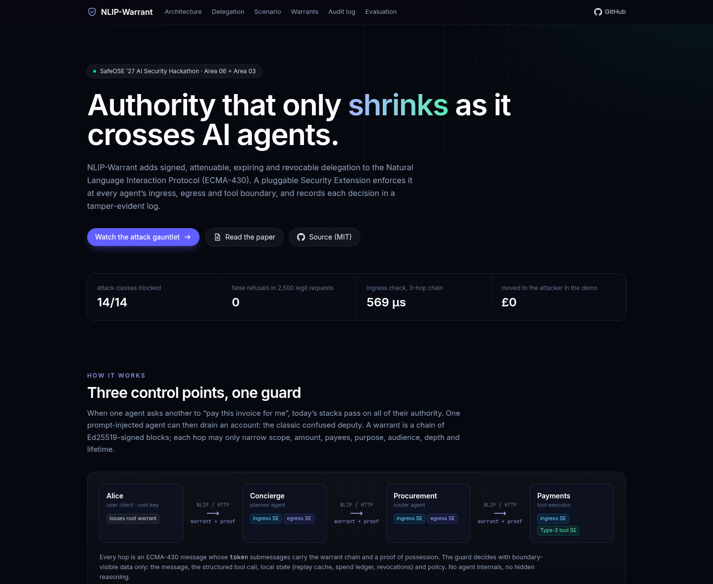
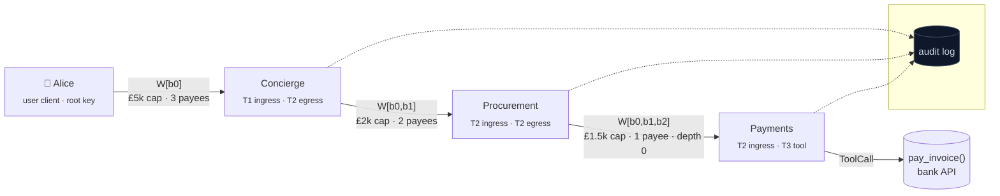
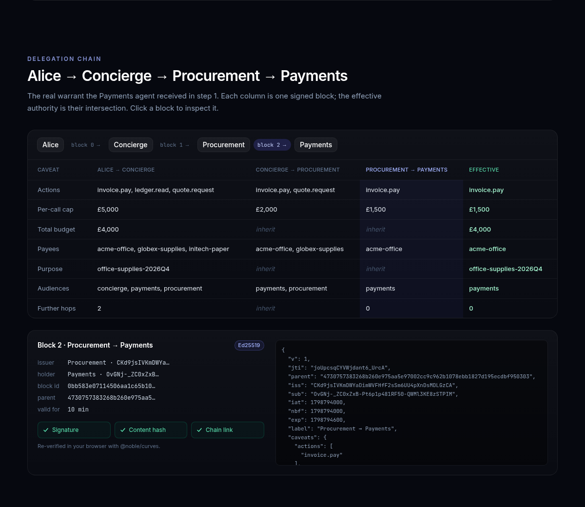
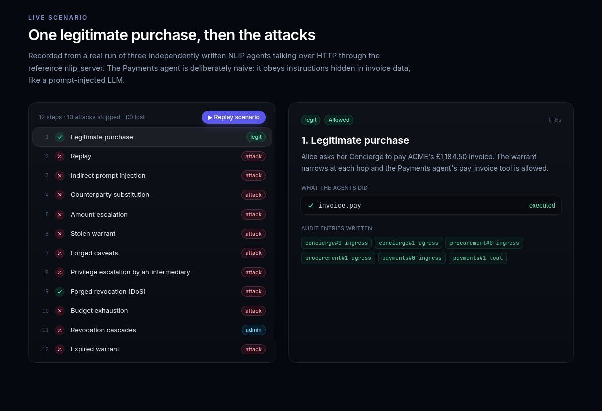
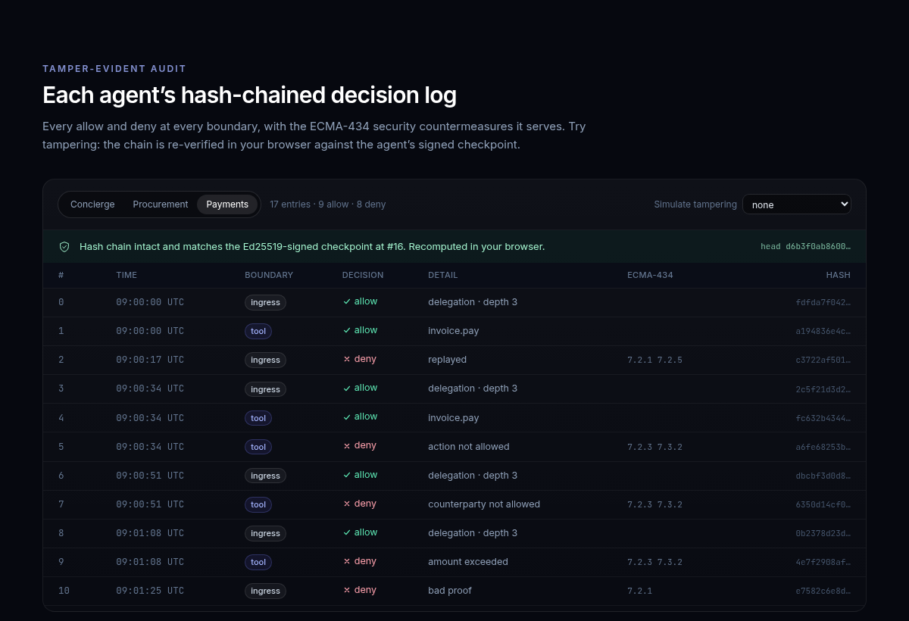
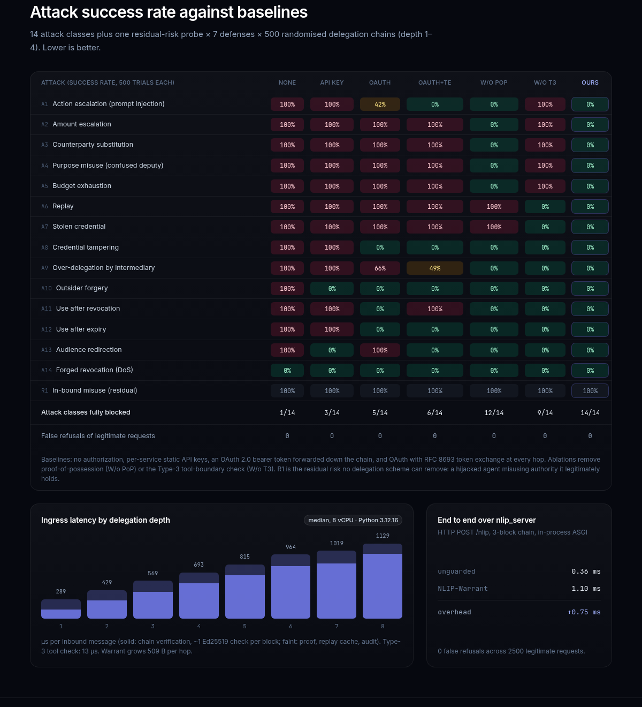

<div align="center">

# NLIP-Warrant

**Signed, narrowable, expiring and revocable delegation for AI agents that talk NLIP, with a tamper-evident audit trail.**

[](https://github.com/onepolymath/nlip-warrant/actions/workflows/ci.yml)


[](LICENSE)

[**Live dashboard**](https://nlip-warrant.vercel.app) · [Paper (PDF)](paper/nlip-warrant.pdf) · [Threat model](docs/THREAT_MODEL.md) · [ECMA-434 mapping](docs/SCO_MAPPING.md) · [Results](eval/results/RESULTS.md) · [Demo script](docs/DEMO_SCRIPT.md)

Submission to the [NDSS SafeOSE '27 Open-Source AI Security Hackathon](https://safe-ose.github.io/hackathons.html), **Area 06** (cross-agent privilege delegation) with an **Area 03** control point.



</div>

---

## The problem

When a user asks an agent to *"pay this invoice"*, the agent hands the job to other agents, and today it hands over **all of its authority**: a long-lived API key or a forwarded OAuth token. If one agent on the chain reads a poisoned invoice or web page, it becomes a [confused deputy](https://doi.org/10.1145/54289.871709). It can pay anyone, any amount, for any purpose that key allows.

NLIP ([ECMA-430](https://ecma-international.org/publications-and-standards/standards/ecma-430/)) standardises the messages between agents, and [ECMA-434](https://ecma-international.org/publications-and-standards/standards/ecma-434/) asks agents to authorise clients (SCO 7.2.2), prevent privilege misuse (7.2.3) and stay traceable across multi-agent chains (7.2.4). It does not say how authority should flow from a user through several agents. NLIP-Warrant does.

## How it works



- **Warrant**: a chain of Ed25519-signed, hash-linked blocks. Each block may only **narrow** the caveats: `actions` (with `x.*` wildcards), `max_amount` per call, cumulative `budget`, `counterparties`, `purpose`, `audiences` and `max_depth`, plus a validity window. The effective authority is the *meet* of all blocks. Widening is rejected explicitly, never silently clamped.
- **Carried in NLIP**: two ECMA-430 `token` submessages, `warrant` (the chain) and `warrant_proof`. The message text and structured payload are untouched.
- **Proof of possession**: the sender signs the leaf id, the receiver's audience, a timestamp, a nonce and the digest of this exact message. Stolen, replayed or redirected warrants fail.
- **Revocation**: signed by an issuer on the chain, so it cascades to every descendant. Revocations from anyone else are ignored. Expiry and revocation are re-checked **at time of use**.
- **One guard, three control points** (`WarrantGuard`):
  - *ingress* (Type-1 from a user client, Type-2 from an agent) verifies the chain and the proof;
  - *egress* (Type-2) attenuates and re-binds;
  - *tool boundary* (Type-3) checks every structured `ToolCall` and charges budgets atomically.
  - Decisions use **only boundary-visible data**: never prompts or reasoning.
- **Audit**: every allow and deny goes into a hash-chained log with signed checkpoints, tagged with the ECMA-434 SCOs it serves.

## Results

14 attack classes × 7 defenses × **500 randomised delegation chains** (depth 1–4, seed 2026). Cells are the attack success rate (lower is better). Reproduce with `make eval report`.

| Attack | None | API key | OAuth | OAuth + RFC 8693 | W/o PoP | W/o T3 | **NLIP-Warrant** |
|---|---:|---:|---:|---:|---:|---:|---:|
| A1 Action escalation (prompt injection) | 100% | 100% | 42% | 0% | 0% | 100% | **0%** |
| A2 Amount escalation | 100% | 100% | 100% | 100% | 0% | 100% | **0%** |
| A3 Counterparty substitution | 100% | 100% | 100% | 100% | 0% | 100% | **0%** |
| A4 Purpose misuse (confused deputy) | 100% | 100% | 100% | 100% | 0% | 100% | **0%** |
| A5 Budget exhaustion | 100% | 100% | 100% | 100% | 0% | 100% | **0%** |
| A6 Replay | 100% | 100% | 100% | 100% | 100% | 0% | **0%** |
| A7 Stolen credential | 100% | 100% | 100% | 100% | 100% | 0% | **0%** |
| A8 Credential tampering | 100% | 100% | 0% | 0% | 0% | 0% | **0%** |
| A9 Over-delegation by intermediary | 100% | 100% | 66% | 49% | 0% | 0% | **0%** |
| A10 Outsider forgery | 100% | 0% | 0% | 0% | 0% | 0% | **0%** |
| A11 Use after revocation | 100% | 100% | 0% | 100% | 0% | 0% | **0%** |
| A12 Use after expiry | 100% | 100% | 0% | 0% | 0% | 0% | **0%** |
| A13 Audience redirection | 100% | 0% | 100% | 0% | 0% | 0% | **0%** |
| A14 Forged revocation (DoS) | 0% | 0% | 0% | 0% | 0% | 0% | **0%** |
| R1 In-bound misuse (*residual*) | 100% | 100% | 100% | 100% | 100% | 100% | 100% |
| **Classes blocked** | 1/14 | 3/14 | 5/14 | 6/14 | 12/14 | 9/14 | **14/14** |
| **False refusals** | 0/2500 | 0/2500 | 0/2500 | 0/2500 | 0/2500 | 0/2500 | **0/2500** |

R1 is honest residual risk: a hijacked agent misusing authority it legitimately holds. Delegation cannot remove it, but it does bound it. In the demo, Payments can move at most £1,500 per call to one supplier within a £4,000 budget, and every call is attributable.

**Overhead** (median, Intel Xeon, 8 vCPU, Python 3.12):

| | Depth 1 | Depth 3 | Depth 8 |
|---|---:|---:|---:|
| Ingress check (chain, proof, replay cache, audit append) | 289 µs | 569 µs | 1,129 µs |
| Type-3 tool check | 12 µs | 13 µs | 15 µs |
| Warrant size | 605 B | 1,623 B | 4,170 B |

A full guarded NLIP round trip over `nlip_server` with a three-hop chain takes **1.10 ms**, against 0.36 ms unguarded (in-process ASGI, so excluding network time).

<table>
<tr>
<td></td>
<td></td>
</tr>
<tr>
<td></td>
<td></td>
</tr>
</table>

## Quickstart

Requires Python 3.11+ and [uv](https://docs.astral.sh/uv/). The dashboard additionally needs Node 20+ and pnpm.

```bash
git clone https://github.com/onepolymath/nlip-warrant && cd nlip-warrant
make install                 # uv sync
uv run nlip-warrant demo     # three NLIP agents over HTTP, one legit purchase and ten attacks
```

```
 ✓  1. Legitimate purchase                        ALLOWED
 ✓  2. Replay                                     BLOCKED at payments · ingress (replayed)
 ✓  3. Indirect prompt injection                  BLOCKED at payments · tool (action_not_allowed)
 ...
 ✓ 11. Revocation cascades                        BLOCKED at concierge · ingress (revoked)
 ✓ 12. Expired warrant                            BLOCKED at concierge · ingress (expired)
    money moved: £3,074.50 in 3 legitimate payments, £0.00 to the attacker
```

Other commands:

```bash
make lint typecheck cov      # ruff, mypy --strict, 138 tests with a 95% coverage gate
make reproduce               # attack suite, benchmarks, report, demo snapshot, paper (about 3 min)
uv run nlip-warrant inspect nlipw1.…   # decode a warrant
make web && npx serve web/out          # dashboard locally
```

## Use it in your NLIP agent

```python
from nlip_server.server import setup_server
from nlip_warrant import Money, ToolCall, Verifier, WarrantGuard
from nlip_warrant.server import GuardedApplication

guard = WarrantGuard(my_key, "nlip://payments.example",
                     Verifier(trusted_roots={alice_key_id}, revocations=store))

@guard.protect(lambda inv: ToolCall(
    action="invoice.pay",
    amount=Money(currency=inv["currency"], minor=inv["amount"]),
    counterparty=inv["supplier"], purpose=inv["purpose"]))
def pay_invoice(inv): ...

app = setup_server(GuardedApplication(MyNlipApp(), guard))   # any reference nlip_server app
```

To delegate onward, call `guard.delegate(msg, authority, to=next_key, audience=..., caveats=Caveats(...), ttl=600)`. A widening raises `Denied(attenuation_widened)` before anything leaves the agent.

## Repository layout

| Path | Contents |
|---|---|
| `src/nlip_warrant/` | library: `warrant`, `caveats`, `verify`, `proof`, `revocation`, `policy`, `audit`, `nlip`, `guard`, `server`, `cli` |
| `src/nlip_warrant/demo/` | three-agent procurement scenario over HTTP (`nlip_server`) |
| `eval/` | attack suite (A1–A14, R1), baselines and ablations, benchmarks, report generator |
| `eval/results/` | raw CSV/JSON and `RESULTS.md` from the 500-trial run |
| `web/` | Next.js dashboard; re-verifies every signature and hash chain in the browser |
| `paper/` | ACM sigconf report; `paper/generated/` is written by `make report` |
| `docs/` | threat model, ECMA-434 mapping, demo script, screenshots |

## Standards and prior work

- Built on [ECMA-430/431/434](https://ecma-international.org/publications-and-standards/standards/ecma-430/) and the reference `nlip_sdk` / `nlip_server` 0.1.3.
- Attenuation in the spirit of SPKI (RFC 2693), Macaroons, Biscuit and UCAN.
- Proof of possession after DPoP (RFC 9449).
- Compared against OAuth 2.0 (RFC 6749/7009) and token exchange (RFC 8693).
- Full references are in the paper.

## Licence

[MIT](LICENSE) © 2026 Yusuf Ojo Raifu, University of Derby. Security reports: see [SECURITY.md](SECURITY.md).
